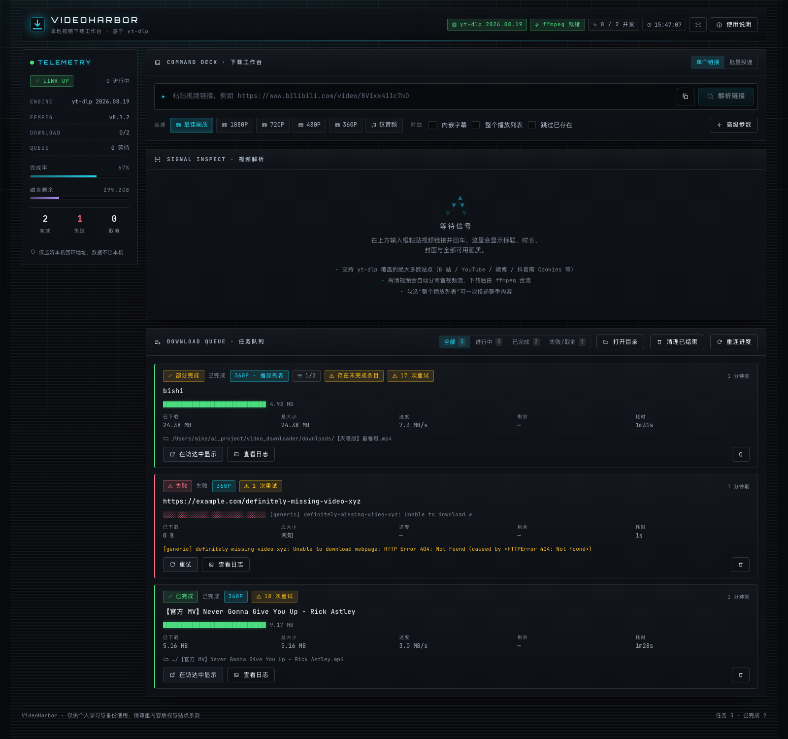

# VideoHarbor · 视频下载神器

> 仓库：https://github.com/Light-ux-source/video_downloader
>
> 一个**本地运行**的视频下载工作台：粘贴链接 → 选画质 → 实时看着它下完。
> 站点适配交给 [yt-dlp](https://github.com/yt-dlp/yt-dlp)（覆盖 1800+ 站点），
> 我们只负责把「解析、选流、下载、合流、进度、容错」编排得顺手。



> 图文帖（图集）解析与下载：[docs/screenshot-gallery.png](docs/screenshot-gallery.png)

---

## 30 秒上手

```bash
git clone https://github.com/Light-ux-source/video_downloader.git video_downloader && cd video_downloader

./setup.sh     # 一次性：准备自带 Python 运行时 + yt-dlp（约 1 分钟，无需 sudo）
./run.sh       # 启动服务
```

浏览器打开 **http://127.0.0.1:8765**，粘贴视频链接并回车。
终端会打印引擎、ffmpeg、JS 运行时的自检结果。

> 需要 `ffmpeg`（高清合流/转码）与 `node`（YouTube 必需）：`brew install ffmpeg node`

---

## 它能做什么

| 能力 | 说明 |
|---|---|
| **链接解析** | 标题、时长、封面、UP 主、全部可用画质与体积，一目了然 |
| **画质选择** | 最佳 / 1080P / 720P / 480P / 360P / 仅音频；也可直接选精确 format id |
| **音频提取** | 一键 MP3（可选 m4a/opus/flac/wav），自动写入元数据与封面 |
| **实时进度** | SSE 推送百分比、速度、剩余时间、当前阶段（下载/合流/转码/内嵌） |
| **任务队列** | 并发下载、排队、取消、重试、删除、按状态筛选、展开看 yt-dlp 原始日志 |
| **批量投递** | 多行粘贴，一次最多 50 个链接自动排队 |
| **播放列表** | 整列表下载或指定条目（`1-5,8`）；显示条目进度，部分失败明确标注 |
| **字幕** | 下载并内嵌字幕（可选自动生成字幕、指定语言） |
| **高级参数** | Cookies 文件 / 从浏览器读 Cookies / 代理 / 限速 / 并发分片 / 自定义格式表达式 |
| **抖音免 Cookie** | 内置专用通道：**无需登录、无需提供 Cookie**，视频拿**无水印**原画（最高 1080p） |
| **抖音图文帖** | 图集逐张下载**无水印原图**，保存到 `标题/图片N.jpeg`；自动识别实况（动图） |

### 自动容错

网络到 CDN 的抖动（`SSL: UNEXPECTED_EOF`、分片被重置）是常态，因此任务执行带**多策略重试**：

1. 按原始设置执行
2. 失败 → 等 5s → 换编码偏好（H.264 ⇄ AV1/VP9/HEVC）
3. 仍失败 → 等 10s → 降并发 + 启用分片下载
4. 仍失败 → 等 15s → 单连接 + 更小分片

以及：

- **永久性错误不重试**（404 / 不支持 / 需登录 / 地区限制），直接给出可操作的中文原因
- **字幕无法内嵌时自动降级**为「只下视频」，不让整个任务失败
- **重试前清理残留分片**，避免继续撞同一条坏流
- **文件已存在识别为「跳过」**而不是误报失败
- **播放列表部分失败不会被误报成功**，会核对产物数与预期条目数并标注「部分完成」
- **抖动自愈不误报**：日志里有放弃记录但产物齐全时，不算失败

---

## 文档索引

| 文档 | 内容 |
|---|---|
| [docs/USAGE.md](docs/USAGE.md) | **使用手册**：界面说明、参数详解、典型场景、快捷键 |
| [docs/ARCHITECTURE.md](docs/ARCHITECTURE.md) | **架构设计**：分层、模块职责、任务生命周期、扩展指引 |
| [docs/API.md](docs/API.md) | **API 参考**：全部接口、字段表、SSE 协议、错误码 |
| [docs/CONFIGURATION.md](docs/CONFIGURATION.md) | **配置**：环境变量、目录、代理与 Cookies、并发与限速 |
| [docs/DEVELOPMENT.md](docs/DEVELOPMENT.md) | **开发**：目录结构、如何改、如何测、构建与调试 |
| [docs/TROUBLESHOOTING.md](docs/TROUBLESHOOTING.md) | **排障**：已知站点限制、报错对照表、诊断工具 |
| [docs/CHANGELOG.md](docs/CHANGELOG.md) | **变更记录**：各轮迭代修了什么、为什么 |
| [docs/DECISIONS.md](docs/DECISIONS.md) | **技术决策记录**（ADR）：关键取舍与理由 |
| [design-system/](design-system/) | UI 设计系统（配色/字体/风格来源） |

---

## 技术栈一览

| 层 | 选型 | 理由 |
|---|---|---|
| 下载引擎 | yt-dlp（PyPI 包，独立进程调用） | 站点覆盖广；升级 = 换包，业务代码零改动 |
| 合流/转码 | ffmpeg | 高清音视频分离流的合流、MP3 转码、字幕内嵌 |
| JS 运行时 | node（自动探测） | YouTube n 挑战必需；新版 yt-dlp 默认只认 deno |
| 后端 | Python **标准库**（`ThreadingHTTPServer`） | 零第三方依赖，`./run.sh` 即跑 |
| 前端 | Vue 3 + Vite（产物入库） | 组件化；产物预构建，clone 后免 `npm install` 即可用 |
| 实时进度 | SSE | 比轮询省资源，比 WebSocket 简单 |
| 存储 | 内存任务表 + `downloads/` 目录 | 无需数据库，符合本机自用场景 |

**为什么后端零依赖、前端产物入库**：目标机器只有系统 Python 3.9 且网络受限，
任何需要联网装包或编译的环节都会变成使用门槛。详见
[docs/DECISIONS.md](docs/DECISIONS.md)。

---

## 项目状态

- 后端自测：**126 项全部通过**（`./run.sh --py tests/run_tests.py`）
- 真实站点验证：B 站（视频/音频/播放列表）、YouTube（1080p 全画质）均实测通过
- 抖音：✅ 已有专用免 Cookie 通道（yt-dlp 自身仍不支持，我们绕过了签名墙）

---

## 许可证

[MIT](LICENSE)。第三方组件：[yt-dlp](https://github.com/yt-dlp/yt-dlp)（Unlicense）、
[Vue 3](https://github.com/vuejs/core)（MIT）、[Vite](https://github.com/vitejs/vite)（MIT）、
[ffmpeg](https://ffmpeg.org/)（LGPL/GPL，作为外部程序调用）。

---

## 免责声明

本项目仅用于**个人学习、备份与合法用途**。请遵守目标站点的服务条款与内容版权，
不要下载或传播无授权内容。默认只监听 `127.0.0.1`，数据不出本机。
